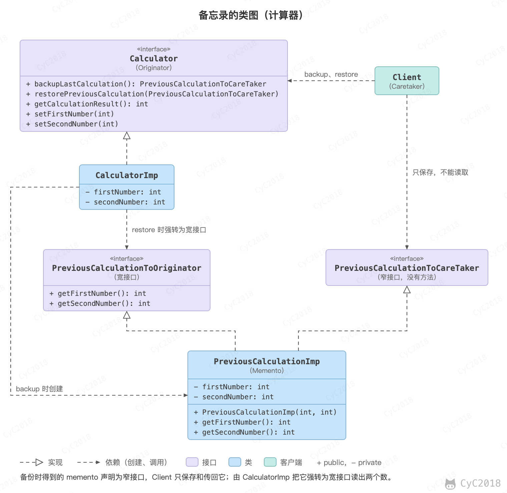

## 备忘录（Memento）

### 意图
在不违反封装的情况下获得对象的内部状态，从而在需要时可以将对象恢复到之前保存的状态。

### 类图
- Originator：原始对象，负责创建备忘录和用备忘录恢复状态；
- Caretaker：负责保存好备忘录；
- Memento：备忘录，存储原始对象的状态。

备忘录对外提供两个接口：提供给 Caretaker 的窄接口，只能保存和传递备忘录，看不到其中的数据；提供给 Originator 的宽接口，可以读出恢复状态所需的所有数据。这样 Caretaker 保管备忘录时不依赖其中的数据，也不会破坏封装。

<div align="center">  </div><br>

### 实现
以下实现了一个简单计算器程序，可以输入两个值，然后计算这两个值的和。备忘录模式允许将这两个值存储起来，然后在某个时刻用存储的状态进行恢复。

代码中的角色：CalculatorImp 是 Originator；PreviousCalculationToCareTaker 是窄接口，没有任何方法；PreviousCalculationToOriginator 是宽接口；PreviousCalculationImp 同时实现这两个接口；Client 是 Caretaker，它只拿到窄接口类型的备忘录。需要注意的是，这里的两个接口都是 public 的，Client 强转后仍能读出数据，隔离只是约定；要真正禁止读取，可以去掉公开的宽接口，把备忘录实现为 Originator 的私有静态嵌套类，只实现窄接口，由 Originator 在内部读取它的字段。

实现参考：[Memento Pattern - Calculator Example - Java Sourcecode](https://www.oodesign.com/memento-pattern-calculator-example-java-sourcecode.html)

```java
/**
 * Originator 接口
 */
public interface Calculator {

    // 创建备忘录
    PreviousCalculationToCareTaker backupLastCalculation();

    // 用备忘录恢复状态
    void restorePreviousCalculation(PreviousCalculationToCareTaker memento);

    int getCalculationResult();

    void setFirstNumber(int firstNumber);

    void setSecondNumber(int secondNumber);
}
```

```java
/**
 * Originator 实现
 */
public class CalculatorImp implements Calculator {

    private int firstNumber;
    private int secondNumber;

    @Override
    public PreviousCalculationToCareTaker backupLastCalculation() {
        // 创建保存两个数的备忘录
        return new PreviousCalculationImp(firstNumber, secondNumber);
    }

    @Override
    public void restorePreviousCalculation(PreviousCalculationToCareTaker memento) {
        this.firstNumber = ((PreviousCalculationToOriginator) memento).getFirstNumber();
        this.secondNumber = ((PreviousCalculationToOriginator) memento).getSecondNumber();
    }

    @Override
    public int getCalculationResult() {
        // 结果是两个数的和
        return firstNumber + secondNumber;
    }

    @Override
    public void setFirstNumber(int firstNumber) {
        this.firstNumber = firstNumber;
    }

    @Override
    public void setSecondNumber(int secondNumber) {
        this.secondNumber = secondNumber;
    }
}
```

```java
/**
 * 提供给 Originator 的宽接口，用于恢复状态
 */
public interface PreviousCalculationToOriginator {
    int getFirstNumber();
    int getSecondNumber();
}
```

```java
/**
 * 提供给 Caretaker 的窄接口
 */
public interface PreviousCalculationToCareTaker {
    // Caretaker 不能进行任何操作
}
```

```java
/**
 * 备忘录实现，同时实现了宽接口和窄接口
 */
public class PreviousCalculationImp implements PreviousCalculationToCareTaker,
        PreviousCalculationToOriginator {

    private int firstNumber;
    private int secondNumber;

    public PreviousCalculationImp(int firstNumber, int secondNumber) {
        this.firstNumber = firstNumber;
        this.secondNumber = secondNumber;
    }

    @Override
    public int getFirstNumber() {
        return firstNumber;
    }

    @Override
    public int getSecondNumber() {
        return secondNumber;
    }
}
```

```java
/**
 * Caretaker
 */
public class Client {

    public static void main(String[] args) {
        Calculator calculator = new CalculatorImp();

        // 用户输入两个数
        calculator.setFirstNumber(10);
        calculator.setSecondNumber(100);
        System.out.println(calculator.getCalculationResult());

        // 保存这次计算，以便出错时恢复
        PreviousCalculationToCareTaker memento = calculator.backupLastCalculation();

        // 用户输入了一个错误的数
        calculator.setFirstNumber(17);
        calculator.setSecondNumber(-290);
        System.out.println(calculator.getCalculationResult());

        // 用户按下 Ctrl + Z，恢复到上一次计算
        calculator.restorePreviousCalculation(memento);
        System.out.println(calculator.getCalculationResult());
    }
}
```

```text
110
-273
110
```

### JDK 中的应用
javax.swing.undo.StateEdit 用到了同样的思路：被编辑的对象实现 StateEditable，修改前后由对象把自己的状态写入 Hashtable，撤销或重做时再用它恢复。序列化可以用来把备忘录保存到文件中，但 Serializable 只是一个标记接口，本身不构成备忘录。

## 参考资料

- 弗里曼. Head First 设计模式 [M]. 中国电力出版社, 2007.
- Gamma E. 设计模式：可复用面向对象软件的基础 [M]. 机械工业出版社, 2007.
