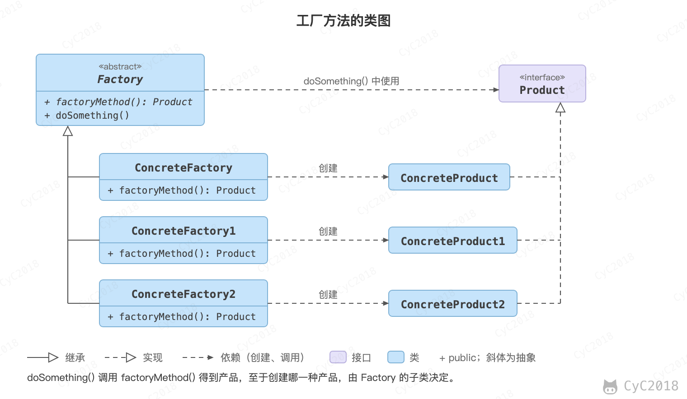

## 工厂方法（Factory Method）

### 意图
定义了一个创建对象的接口，但由子类决定要实例化哪个类。工厂方法把实例化操作推迟到子类。

### 类图
在简单工厂中，创建对象的是另一个类，而在工厂方法中，是由子类来创建对象。简单工厂用一组 if/else 决定创建哪个产品，新增产品要修改工厂类；工厂方法新增产品时只需要新增一个工厂子类，已有的工厂和产品类不用改，由使用方选择用哪个工厂。

下图中，Factory 有一个 doSomething() 方法，这个方法需要用到一个产品对象，这个产品对象由 factoryMethod() 方法创建。该方法是抽象的，需要由子类去实现。

<div align="center">  </div><br>

### 实现
```java
public abstract class Factory {
    abstract public Product factoryMethod();
    public void doSomething() {
        Product product = factoryMethod();
        // do something with the product
    }
}
```

```java
public class ConcreteFactory extends Factory {
    public Product factoryMethod() {
        return new ConcreteProduct();
    }
}
```

```java
public class ConcreteFactory1 extends Factory {
    public Product factoryMethod() {
        return new ConcreteProduct1();
    }
}
```

```java
public class ConcreteFactory2 extends Factory {
    public Product factoryMethod() {
        return new ConcreteProduct2();
    }
}
```

### JDK 中的应用
Collection#iterator() 是 JDK 中典型的工厂方法：接口只规定返回 Iterator，由各个实现类决定创建哪一种迭代器，例如 ArrayList 返回 ArrayList$Itr，HashSet 返回 HashMap$KeyIterator（JDK 21 实测，见[附录 A1](#a1-迭代器的实际类型)）。URLStreamHandlerFactory#createURLStreamHandler() 也是由实现类决定创建哪种对象。

下面几个静态方法常被一起列出，它们按参数或环境决定返回哪个子类（例如 Calendar.getInstance() 返回 GregorianCalendar），不经过子类覆盖，严格说是静态工厂方法，更接近[简单工厂](设计模式%20-%20简单工厂.md)：

- [java.util.Calendar#getInstance()](http://docs.oracle.com/javase/8/docs/api/java/util/Calendar.html#getInstance--)
- [java.util.ResourceBundle#getBundle()](http://docs.oracle.com/javase/8/docs/api/java/util/ResourceBundle.html#getBundle-java.lang.String-)
- [java.text.NumberFormat#getInstance()](http://docs.oracle.com/javase/8/docs/api/java/text/NumberFormat.html#getInstance--)
- [java.nio.charset.Charset#forName()](https://docs.oracle.com/javase/8/docs/api/java/nio/charset/Charset.html#forName-java.lang.String-)
- [java.util.EnumSet#of()](https://docs.oracle.com/javase/8/docs/api/java/util/EnumSet.html#of-E-)

## 附录：实测

### A1 迭代器的实际类型

环境：JDK 21.0.13（Adoptium），macOS，默认区域设置为中国。

```java
Collection<?>[] cs = { new ArrayList<>(), new LinkedList<>(), new HashSet<>(), new ArrayDeque<>() };
for (Collection<?> c : cs)
    System.out.println(c.getClass().getSimpleName() + ".iterator() -> " + c.iterator().getClass().getName());
System.out.println(Calendar.getInstance().getClass().getName());
```

```text
ArrayList.iterator() -> java.util.ArrayList$Itr
LinkedList.iterator() -> java.util.LinkedList$ListItr
HashSet.iterator() -> java.util.HashMap$KeyIterator
ArrayDeque.iterator() -> java.util.ArrayDeque$DeqIterator
java.util.GregorianCalendar
```

## 参考资料

- 弗里曼. Head First 设计模式 [M]. 中国电力出版社, 2007.
- Gamma E. 设计模式：可复用面向对象软件的基础 [M]. 机械工业出版社, 2007.
