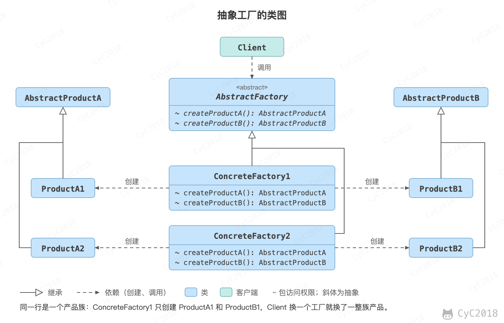

## 4. 抽象工厂（Abstract Factory）

### 意图
提供一个接口，用于创建相关的对象家族。

### 类图
抽象工厂模式创建的是对象家族，也就是多种相关的产品，并且要配套使用。例如一个同时支持 MySQL 和 PostgreSQL 的数据访问层，连接对象和生成分页 SQL 的方言对象必须来自同一种数据库，MySQL 的连接配上 PostgreSQL 的方言就会出错。而工厂方法模式只负责创建一种产品，这和抽象工厂模式有很大不同。

抽象工厂模式用到了工厂方法模式来创建单一对象，AbstractFactory 中的 createProductA() 和 createProductB() 方法都是让子类来实现，这两个方法单独来看就是在创建一个对象，这符合工厂方法模式的定义。

家族的约束由具体工厂保证：ConcreteFactory1 只生产 ProductA1 和 ProductB1，ConcreteFactory2 只生产 ProductA2 和 ProductB2。Client 选定一个工厂以后，拿到的 A 和 B 一定配套；换一个工厂，就整体换成另一套产品。新增一个产品族只需新增一个具体工厂；新增一种产品（例如 ProductC）则要修改 AbstractFactory 和所有具体工厂。

从高层次来看，抽象工厂使用了组合，即 Client 组合了 AbstractFactory，而工厂方法模式使用了继承。

<div align="center">  </div><br>

### 实现
```java
public class AbstractProductA {
}
```

```java
public class AbstractProductB {
}
```

```java
public class ProductA1 extends AbstractProductA {
}
```

```java
public class ProductA2 extends AbstractProductA {
}
```

```java
public class ProductB1 extends AbstractProductB {
}
```

```java
public class ProductB2 extends AbstractProductB {
}
```

```java
public abstract class AbstractFactory {
    abstract AbstractProductA createProductA();
    abstract AbstractProductB createProductB();
}
```

```java
public class ConcreteFactory1 extends AbstractFactory {
    AbstractProductA createProductA() {
        return new ProductA1();
    }

    AbstractProductB createProductB() {
        return new ProductB1();
    }
}
```

```java
public class ConcreteFactory2 extends AbstractFactory {
    AbstractProductA createProductA() {
        return new ProductA2();
    }

    AbstractProductB createProductB() {
        return new ProductB2();
    }
}
```

```java
public class Client {
    public static void main(String[] args) {
        AbstractFactory abstractFactory = new ConcreteFactory1();
        AbstractProductA productA = abstractFactory.createProductA();
        AbstractProductB productB = abstractFactory.createProductB();
        // do something with productA and productB
    }
}
```

### JDK 中的应用
- [javax.xml.parsers.DocumentBuilderFactory](http://docs.oracle.com/javase/8/docs/api/javax/xml/parsers/DocumentBuilderFactory.html)
- [javax.xml.transform.TransformerFactory](http://docs.oracle.com/javase/8/docs/api/javax/xml/transform/TransformerFactory.html#newInstance--)
- [javax.xml.xpath.XPathFactory](http://docs.oracle.com/javase/8/docs/api/javax/xml/xpath/XPathFactory.html#newInstance--)

## 参考资料

- 弗里曼. Head First 设计模式 [M]. 中国电力出版社, 2007.
- Gamma E. 设计模式：可复用面向对象软件的基础 [M]. 机械工业出版社, 2007.
