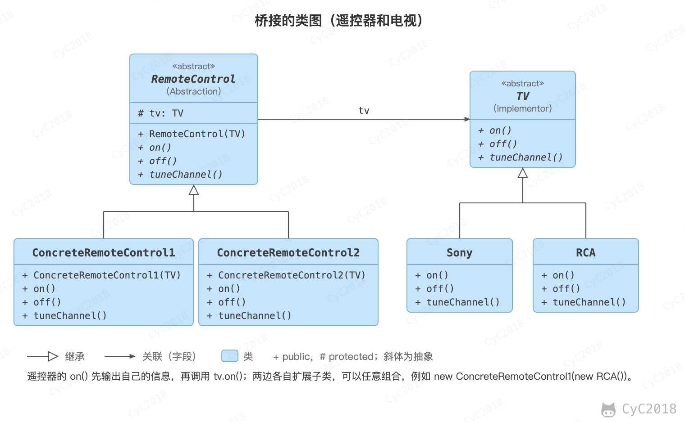

## 桥接（Bridge）

### 意图
将抽象与实现分离开来，使它们可以独立变化。

### 类图
- Abstraction：定义抽象类的接口，并持有一个 Implementor 的引用；
- Implementor：定义实现类接口。

<div align="center">  </div><br>

### 实现
RemoteControl 表示遥控器，指代 Abstraction。

TV 表示电视，指代 Implementor。

桥接模式将遥控器和电视分离开来，从而可以独立改变遥控器或者电视的实现。如果用继承同时表达这两个维度，2 种遥控器 × 2 种电视需要 4 个子类，再加一种电视又要加 2 个；让遥控器持有一个 TV 引用以后，两个维度各自扩展，类的数量从相乘变为相加。

```java
public abstract class TV {
    public abstract void on();

    public abstract void off();

    public abstract void tuneChannel();
}
```

```java
public class Sony extends TV {
    @Override
    public void on() {
        System.out.println("Sony.on()");
    }

    @Override
    public void off() {
        System.out.println("Sony.off()");
    }

    @Override
    public void tuneChannel() {
        System.out.println("Sony.tuneChannel()");
    }
}
```

```java
public class RCA extends TV {
    @Override
    public void on() {
        System.out.println("RCA.on()");
    }

    @Override
    public void off() {
        System.out.println("RCA.off()");
    }

    @Override
    public void tuneChannel() {
        System.out.println("RCA.tuneChannel()");
    }
}
```

```java
public abstract class RemoteControl {
    protected TV tv;

    public RemoteControl(TV tv) {
        this.tv = tv;
    }

    public abstract void on();

    public abstract void off();

    public abstract void tuneChannel();
}
```

```java
public class ConcreteRemoteControl1 extends RemoteControl {
    public ConcreteRemoteControl1(TV tv) {
        super(tv);
    }

    @Override
    public void on() {
        System.out.println("ConcreteRemoteControl1.on()");
        tv.on();
    }

    @Override
    public void off() {
        System.out.println("ConcreteRemoteControl1.off()");
        tv.off();
    }

    @Override
    public void tuneChannel() {
        System.out.println("ConcreteRemoteControl1.tuneChannel()");
        tv.tuneChannel();
    }
}
```

```java
public class ConcreteRemoteControl2 extends RemoteControl {
    public ConcreteRemoteControl2(TV tv) {
        super(tv);
    }

    @Override
    public void on() {
        System.out.println("ConcreteRemoteControl2.on()");
        tv.on();
    }

    @Override
    public void off() {
        System.out.println("ConcreteRemoteControl2.off()");
        tv.off();
    }

    @Override
    public void tuneChannel() {
        System.out.println("ConcreteRemoteControl2.tuneChannel()");
        tv.tuneChannel();
    }
}
```

```java
public class Client {
    public static void main(String[] args) {
        RemoteControl remoteControl1 = new ConcreteRemoteControl1(new RCA());
        remoteControl1.on();
        remoteControl1.off();
        remoteControl1.tuneChannel();
        RemoteControl remoteControl2 = new ConcreteRemoteControl2(new Sony());
        remoteControl2.on();
        remoteControl2.off();
        remoteControl2.tuneChannel();
    }
}
```

```text
ConcreteRemoteControl1.on()
RCA.on()
ConcreteRemoteControl1.off()
RCA.off()
ConcreteRemoteControl1.tuneChannel()
RCA.tuneChannel()
ConcreteRemoteControl2.on()
Sony.on()
ConcreteRemoteControl2.off()
Sony.off()
ConcreteRemoteControl2.tuneChannel()
Sony.tuneChannel()
```

### JDK 中的应用
- AWT：组件类是抽象，java.awt.peer 中与平台相关的 peer 是实现，把窗口功能映射到不同的操作系统；
- JDBC：应用面向 JDBC 接口编程，各数据库厂商的驱动是实现。

## 参考资料

- 弗里曼. Head First 设计模式 [M]. 中国电力出版社, 2007.
- Gamma E. 设计模式：可复用面向对象软件的基础 [M]. 机械工业出版社, 2007.
