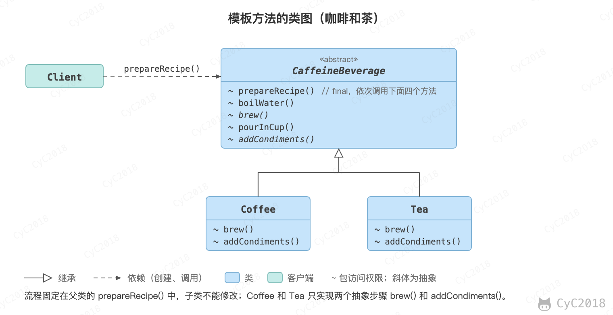
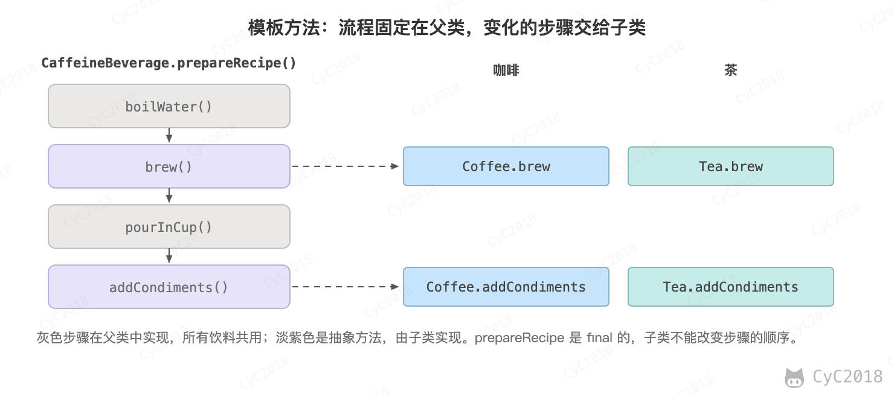

## 模板方法（Template Method）

### 意图
定义算法框架，并将一些步骤的实现延迟到子类。

通过模板方法，子类可以重新定义算法的某些步骤，而不用改变算法的结构。

### 类图
<div align="center">  </div><br>

### 实现
冲咖啡和冲茶都有类似的流程，但是某些步骤会有点不一样，要求复用那些相同步骤的代码。

<div align="center">  </div><br>

```java
public abstract class CaffeineBeverage {

    final void prepareRecipe() {
        boilWater();
        brew();
        pourInCup();
        addCondiments();
    }

    abstract void brew();

    abstract void addCondiments();

    void boilWater() {
        System.out.println("boilWater");
    }

    void pourInCup() {
        System.out.println("pourInCup");
    }
}
```

```java
public class Coffee extends CaffeineBeverage {
    @Override
    void brew() {
        System.out.println("Coffee.brew");
    }

    @Override
    void addCondiments() {
        System.out.println("Coffee.addCondiments");
    }
}
```

```java
public class Tea extends CaffeineBeverage {
    @Override
    void brew() {
        System.out.println("Tea.brew");
    }

    @Override
    void addCondiments() {
        System.out.println("Tea.addCondiments");
    }
}
```

```java
public class Client {
    public static void main(String[] args) {
        CaffeineBeverage caffeineBeverage = new Coffee();
        caffeineBeverage.prepareRecipe();
        System.out.println("-----------");
        caffeineBeverage = new Tea();
        caffeineBeverage.prepareRecipe();
    }
}
```

```text
boilWater
Coffee.brew
pourInCup
Coffee.addCondiments
-----------
boilWater
Tea.brew
pourInCup
Tea.addCondiments
```

prepareRecipe() 用 final 修饰，子类不能改变步骤和顺序，必须实现的只有 brew() 和 addCondiments() 这两个抽象步骤。

模板方法通过继承固定流程、替换其中的步骤，[策略](设计模式%20-%20策略.md)通过组合替换整个算法。

### JDK 中的应用
InputStream#read(byte[], int, int) 是一个模板方法：它循环调用抽象的 read() 逐个读取字节，子类只实现读一个字节的 read() 就能批量读取。AQS（AbstractQueuedSynchronizer）也是这样：acquire() 固定了获取失败后排队、挂起的流程，子类（例如 ReentrantLock 内部的 FairSync、NonfairSync）只实现 tryAcquire()，见 [AQS](Java%20并发.md#七juc---aqs)。

- java.io.InputStream#skip()
- java.io.InputStream#read(byte[], int, int)
- java.util.AbstractList#indexOf()

## 参考资料

- 弗里曼. Head First 设计模式 [M]. 中国电力出版社, 2007.
- Gamma E. 设计模式：可复用面向对象软件的基础 [M]. 机械工业出版社, 2007.
