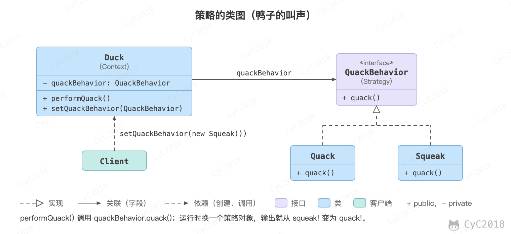

## 9. 策略（Strategy）

### 意图
定义一系列算法，封装每个算法，并使它们可以互换。

策略模式可以让算法独立于使用它的客户端。

### 类图
- Strategy 接口定义了一个算法族，它们都实现了 behavior() 方法；
- Context 是使用到该算法族的类，其中的 doSomething() 方法会调用 behavior()，setStrategy(Strategy) 方法可以动态地改变 strategy 对象，即可以在运行时更换 Context 使用的算法。

下图按后文的鸭子示例画出：Duck 是 Context，QuackBehavior 是 Strategy，quack()、performQuack() 和 setQuackBehavior() 分别对应 behavior()、doSomething() 和 setStrategy()。

<div align="center">  </div><br>

### 实现
设计一个鸭子，它可以动态地改变叫声。这里的算法族是鸭子的叫声行为。

```java
public interface QuackBehavior {
    void quack();
}
```

```java
public class Quack implements QuackBehavior {
    @Override
    public void quack() {
        System.out.println("quack!");
    }
}
```

```java
public class Squeak implements QuackBehavior{
    @Override
    public void quack() {
        System.out.println("squeak!");
    }
}
```

```java
public class Duck {

    private QuackBehavior quackBehavior;

    public void performQuack() {
        if (quackBehavior != null) {
            quackBehavior.quack();
        }
    }

    public void setQuackBehavior(QuackBehavior quackBehavior) {
        this.quackBehavior = quackBehavior;
    }
}
```

```java
public class Client {

    public static void main(String[] args) {
        Duck duck = new Duck();
        duck.setQuackBehavior(new Squeak());
        duck.performQuack();
        duck.setQuackBehavior(new Quack());
        duck.performQuack();
    }
}
```

```text
squeak!
quack!
```

#### 1. 用策略替代 if-else

业务代码中，同一件事常按类型分别处理，例如按配送方式计算运费。这里的规则是：标准快递首千克 10 元，之后每千克加 3 元；加急快递首千克 25 元，之后每千克加 6 元；到店自提免运费。调用方先把重量向上取整为千克数 kg，例如 2.5 kg 取 3。

```java
public class IfElseFreightService {

    public int freight(String type, int kg) {
        if ("STANDARD".equals(type)) {
            return 10 + (kg - 1) * 3;
        } else if ("EXPRESS".equals(type)) {
            return 25 + (kg - 1) * 6;
        } else if ("PICKUP".equals(type)) {
            return 0;
        }
        throw new IllegalArgumentException("未知配送方式: " + type);
    }
}
```

这种写法的问题是：每新增一种配送方式都要修改 freight()，各分支的计费规则耦合在一个方法中，测试时也只能整体验证。把每个分支拆成一个策略类后，接口为：

```java
public interface FreightStrategy {

    int fee(int kg);
}
```

每个实现类只包含一种计费规则。FreightStrategy 是 Strategy，三个实现类是 ConcreteStrategy：

```java
public class StandardFreight implements FreightStrategy {

    @Override
    public int fee(int kg) {
        return 10 + (kg - 1) * 3;
    }
}

public class ExpressFreight implements FreightStrategy {

    @Override
    public int fee(int kg) {
        return 25 + (kg - 1) * 6;
    }
}

public class PickupFreight implements FreightStrategy {

    @Override
    public int fee(int kg) {
        return 0;
    }
}
```

同样的结构也适用于支付渠道、消息推送渠道等场景，只是各实现类的内容换成对应的处理逻辑。

#### 2. 与简单工厂和 Spring 容器结合

策略模式还要解决按类型找到策略对象的问题，这一步与[简单工厂](设计模式%20-%20简单工厂.md)相同：工厂根据类型返回对象，再由对象执行计算。两者的分工是：工厂决定取得哪一个对象，策略决定执行哪一种算法。用 Map 保存类型与策略的对应关系，即可实现这个工厂：

```java
import java.util.Map;

public class FreightStrategyFactory {

    private static final Map<String, FreightStrategy> STRATEGIES = Map.of(
            "STANDARD", new StandardFreight(),
            "EXPRESS", new ExpressFreight(),
            "PICKUP", new PickupFreight());

    public static FreightStrategy of(String type) {
        FreightStrategy strategy = STRATEGIES.get(type);
        if (strategy == null) {
            throw new IllegalArgumentException("未知配送方式: " + type);
        }
        return strategy;
    }
}
```

调用方式为 `FreightStrategyFactory.of("EXPRESS").fee(3)`，结果是 37，即 25 + (3 - 1) * 6。

在 Spring 中可以不用手写 Map。容器会把实现同一接口的 Bean 收集为 Map<String, 接口>，key 是 Bean 名称（见[附录 A2](#a2-spring-中的-map-注入)）。实现类用 @Component 指定名称，名称即为配送方式的编码：

```java
import org.springframework.stereotype.Component;

@Component("STANDARD")
public class StandardFreight implements FreightStrategy {

    @Override
    public int fee(int kg) {
        return 10 + (kg - 1) * 3;
    }
}
```

ExpressFreight 和 PickupFreight 分别标注为 `@Component("EXPRESS")` 和 `@Component("PICKUP")`，FreightService 的写法如下：

```java
import java.util.Map;
import org.springframework.stereotype.Service;

@Service
public class FreightService {

    private final Map<String, FreightStrategy> strategies;

    public FreightService(Map<String, FreightStrategy> strategies) {
        this.strategies = strategies;
    }

    public int freight(String type, int kg) {
        FreightStrategy strategy = strategies.get(type);
        if (strategy == null) {
            throw new IllegalArgumentException("未知配送方式: " + type);
        }
        return strategy.fee(kg);
    }
}
```

新增配送方式时只需新增一个带 @Component 的实现类，FreightService 不需要改动。实测中新增 `@Component("SAME_CITY")` 的类后，注入的 Map 多出了 SAME_CITY 这个 key（见[附录 A2](#a2-spring-中的-map-注入)）。

#### 3. 优缺点与注意事项

优点：
- 新增算法时只需新增类，已有的策略和调用方不需要修改，符合开闭原则；
- 每个策略可以单独测试。

缺点：
- 算法较多时类的数量随之增加，即常说的类爆炸问题；
- 调用方要先选出策略，通常由工厂或 Map 负责。

注意事项：
- 工厂和 Spring 中的策略对象只有一个，被所有请求共享，应当是无状态的：计算过程中的数据放在参数和局部变量里，不要存到成员变量中，否则并发请求会互相覆盖，见[Bean 的作用域与线程安全](Spring.md#bean-的作用域与线程安全)；
- 策略接口只有一个方法、实现又很简单时，可以用 Lambda 代替实现类以减少类的数量，例如 `Map<String, IntUnaryOperator>` 的值写成 `kg -> 25 + (kg - 1) * 6`（[附录 A1](#a1-运费策略与-if-else-对拍)中验证了这种写法）；
- 模板方法通过继承固定算法的骨架，由子类覆写其中的步骤；策略通过组合替换整个算法；
- 责任链中的请求依次经过多个处理者，策略则只选择一个算法执行；
- 用策略替代已有的 if-else 时，可以像[附录 A1](#a1-运费策略与-if-else-对拍)那样用同一组输入对比新旧实现的结果，确认一致后再切换。

### 与状态模式的比较

[状态模式](设计模式%20-%20状态.md)和策略模式的类图相似，都是通过组合一个接口对象来动态改变行为，区别在于这个对象是如何被切换的。

状态模式的 State 对象随运行过程中的状态转移而切换，转移由状态对象或 Context 的内部逻辑触发。例如订单处于“待支付”时调用 pay() 会完成支付，进入“已支付”后再调用 pay() 会被拒绝。

策略模式的 Strategy 对象由客户端创建并交给 Context，之后客户端通过 Context 使用它，需要时再替换为另一个策略。例如先为订单设置“标准快递”的运费计算策略，用户改选“加急”后替换为加急策略。

### JDK 中的应用
- java.util.Comparator#compare()
- java.util.concurrent.RejectedExecutionHandler#rejectedExecution()：ThreadPoolExecutor 无法接收任务时调用它，AbortPolicy、CallerRunsPolicy、DiscardPolicy 和 DiscardOldestPolicy 是它的四种实现，通过构造方法或 setRejectedExecutionHandler() 设置。

## 附录：实测

### A1 运费策略与 if-else 对拍

环境：OpenJDK 21.0.13，macOS 15.8.1（arm64）。

用正文中的 IfElseFreightService、FreightStrategy、三个策略实现类和 FreightStrategyFactory 编译，另写一个对拍程序：对 STANDARD、EXPRESS、PICKUP、SAME_CITY 四种类型，各取 kg 为 1～20，共 80 组，比较 if-else 版本、工厂版本和 Lambda 版本的返回值与异常信息。

```text
javac -encoding UTF-8 -d out *.java
java -cp out Main
```

原始输出：

```text
checked=80 mismatch=0
2.5 kg 按 3 kg 计: STANDARD=16 EXPRESS=37 PICKUP=0
lambda EXPRESS(3)=37
unknown: 未知配送方式: SAME_CITY
```

为确认对拍能够发现错误，分别注入两处错误后重跑：工厂中 EXPRESS 对应 StandardFreight，mismatch=20；标准快递的计算改为 10 + kg * 3（续重少减 1 千克），mismatch=20。

### A2 Spring 中的 Map 注入

环境：Spring Boot 3.5.16（Spring Framework 6.2.19），JDK 21.0.13，Maven 3.9.16，macOS 15.8.1（arm64）。

最小项目包含 FreightStrategy 接口、三个带 @Component 的实现类、FreightService（构造器注入 Map<String, FreightStrategy>），以及用 ApplicationRunner 打印结果的启动类。运行输出：

```text
Map 注入的 key（Bean 名）: [EXPRESS, PICKUP, STANDARD]
2.5 kg 按 3 kg 计: STANDARD=16 EXPRESS=37 PICKUP=0
unknown: 未知配送方式: SAME_CITY
```

扩展实验：新增 `@Component("SAME_CITY")` 的实现类，FreightService 不做修改，输出的 key 变为 [EXPRESS, PICKUP, SAME_CITY, STANDARD]，SAME_CITY 可以正常计算。Spring 官方文档说明，Map 注入时值为该类型的所有 Bean，key 为对应的 Bean 名称。

## 参考资料

- 弗里曼. Head First 设计模式 [M]. 中国电力出版社, 2007.
- Gamma E. 设计模式：可复用面向对象软件的基础 [M]. 机械工业出版社, 2007.
- [Using @Autowired](https://docs.spring.io/spring-framework/reference/core/beans/annotation-config/autowired.html)
