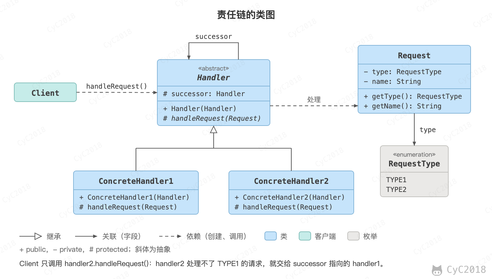

## 责任链（Chain Of Responsibility）

### 意图
使多个对象都有机会处理请求，从而避免请求的发送者和接收者之间的耦合关系。将这些对象连成一条链，并沿着这条链发送该请求，直到有一个对象处理它为止。

### 类图
- Handler：定义处理请求的接口，并且实现后继链（successor）；
- ConcreteHandler：处理自己负责的请求，处理不了就转发给后继者。

<div align="center">  </div><br>

### 实现
```java
public abstract class Handler {

    protected Handler successor;

    public Handler(Handler successor) {
        this.successor = successor;
    }

    protected abstract void handleRequest(Request request);
}
```

```java
public class ConcreteHandler1 extends Handler {

    public ConcreteHandler1(Handler successor) {
        super(successor);
    }

    @Override
    protected void handleRequest(Request request) {
        if (request.getType() == RequestType.TYPE1) {
            System.out.println(request.getName() + " is handled by ConcreteHandler1");
            return;
        }
        if (successor != null) {
            successor.handleRequest(request);
        }
    }
}
```

```java
public class ConcreteHandler2 extends Handler {

    public ConcreteHandler2(Handler successor) {
        super(successor);
    }

    @Override
    protected void handleRequest(Request request) {
        if (request.getType() == RequestType.TYPE2) {
            System.out.println(request.getName() + " is handled by ConcreteHandler2");
            return;
        }
        if (successor != null) {
            successor.handleRequest(request);
        }
    }
}
```

```java
public class Request {

    private RequestType type;
    private String name;

    public Request(RequestType type, String name) {
        this.type = type;
        this.name = name;
    }

    public RequestType getType() {
        return type;
    }

    public String getName() {
        return name;
    }
}
```

```java
public enum RequestType {
    TYPE1, TYPE2
}
```

```java
public class Client {

    public static void main(String[] args) {
        Handler handler1 = new ConcreteHandler1(null);
        Handler handler2 = new ConcreteHandler2(handler1);

        Request request1 = new Request(RequestType.TYPE1, "request1");
        handler2.handleRequest(request1);

        Request request2 = new Request(RequestType.TYPE2, "request2");
        handler2.handleRequest(request2);
    }
}
```

```text
request1 is handled by ConcreteHandler1
request2 is handled by ConcreteHandler2
```

Client 把 handler1 设为 handler2 的后继，请求都从 handler2 进入：request1 是 TYPE1，handler2 处理不了，转给 handler1；request2 由 handler2 直接处理。Client 只认识链头，增删处理者或调整顺序都不影响它。

实际项目中更常见的是另一种写法：每个处理者都处理一次再交给下一个，任何一个处理者都可以中断链条，例如 Servlet 的 Filter、Spring MVC 的拦截器和[下单前的校验](设计模式%20-%20目录.md#项目中的用法)。

### JDK 中的应用
- [java.util.logging.Logger#log()](http://docs.oracle.com/javase/8/docs/api/java/util/logging/Logger.html#log%28java.util.logging.Level,%20java.lang.String%29)
- [Apache Commons Chain](https://commons.apache.org/dormant/commons-chain/)（开源库，不属于 JDK）
- [javax.servlet.Filter#doFilter()](http://docs.oracle.com/javaee/7/api/javax/servlet/Filter.html#doFilter-javax.servlet.ServletRequest-javax.servlet.ServletResponse-javax.servlet.FilterChain-)（Servlet API，不属于 JDK）

## 参考资料

- 弗里曼. Head First 设计模式 [M]. 中国电力出版社, 2007.
- Gamma E. 设计模式：可复用面向对象软件的基础 [M]. 机械工业出版社, 2007.
