# 集群
<!-- GFM-TOC -->
* [集群](#集群)
    * [一、负载均衡](#一负载均衡) 🔥
        * [负载均衡算法](#负载均衡算法)
            * [1. 轮询（Round Robin）](#1-轮询round-robin)
            * [2. 加权轮询（Weighted Round Robin）](#2-加权轮询weighted-round-robin)
            * [3. 最少连接（Least Connections）](#3-最少连接least-connections)
            * [4. 加权最少连接（Weighted Least Connection）](#4-加权最少连接weighted-least-connection)
            * [5. 随机算法（Random）](#5-随机算法random)
            * [6. 源地址哈希法 (IP Hash)](#6-源地址哈希法-ip-hash)
        * [转发实现](#转发实现)
            * [1. HTTP 重定向](#1-http-重定向)
            * [2. DNS 域名解析](#2-dns-域名解析)
            * [3. 反向代理服务器](#3-反向代理服务器)
            * [4. 网络层](#4-网络层)
            * [5. 链路层](#5-链路层)
    * [二、集群下的 Session 管理](#二集群下的-session-管理)
        * [Sticky Session](#sticky-session)
        * [Session Replication](#session-replication)
        * [Session Server](#session-server)
        * [客户端保存](#客户端保存)
<!-- GFM-TOC -->

## 一、负载均衡 🔥

集群中的应用服务器（节点）通常被设计成无状态，用户可以请求任何一个节点。

负载均衡器会根据集群中每个节点的负载情况，将用户请求转发到合适的节点上。

负载均衡器可以用来实现高可用以及伸缩性：

- 高可用：负载均衡器通过健康检查发现某个节点故障时，会将用户请求转发到另外的节点上，从而保证所有服务持续可用；
- 伸缩性：根据系统整体负载情况，可以很容易地添加或移除节点。

负载均衡器运行过程包含两个部分：

1. 根据负载均衡算法得到转发的节点；
2. 进行转发。

### 负载均衡算法

#### 1. 轮询（Round Robin）

轮询算法把每个请求轮流发送到每个服务器上。

下图中，6 个请求按 (1, 2, 3, 4, 5, 6) 的顺序到达。(1, 3, 5) 的请求会被发送到服务器 1，(2, 4, 6) 的请求会被发送到服务器 2。

 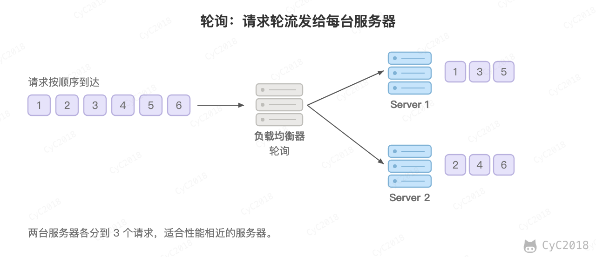 
 

该算法比较适合每个服务器的性能差不多的场景，如果有性能存在差异的情况下，那么性能较差的服务器可能无法承担过大的负载（下图的 Server 2）。

 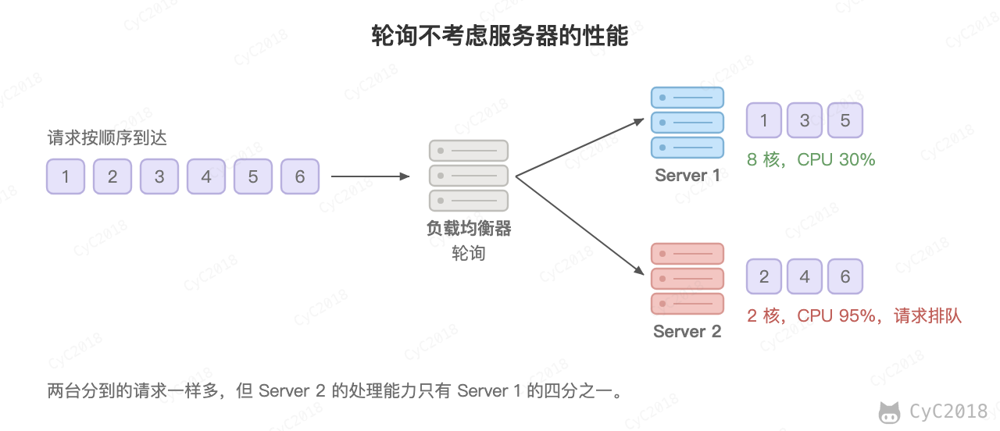 
 

#### 2. 加权轮询（Weighted Round Robin）

加权轮询是在轮询的基础上，根据服务器的性能差异，为服务器赋予一定的权值，性能高的服务器分配更高的权值。

例如下图中，服务器 1 被赋予的权值为 5，服务器 2 被赋予的权值为 1，那么 (1, 2, 3, 4, 5) 请求会被发送到服务器 1，(6) 请求会被发送到服务器 2。

 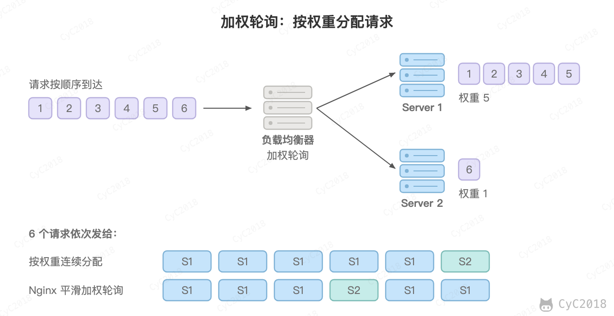 
 

实际实现（例如 Nginx 的平滑加权轮询）会把请求交错发送，避免连续的请求集中到同一台服务器上，上图最后一行是按 Nginx 源码中的算法计算出的顺序。

#### 3. 最少连接（Least Connections）

由于每个请求的连接时间不一样，使用轮询或者加权轮询算法的话，可能会让一台服务器当前连接数过大，而另一台服务器的连接过小，造成负载不均衡。

例如下图中，(1, 3, 5) 请求会被发送到服务器 1，但是 (1, 3) 很快就断开连接，此时只有 (5) 请求连接服务器 1；(2, 4, 6) 请求被发送到服务器 2，只有 (2) 的连接断开，此时 (6, 4) 请求连接服务器 2。该系统继续运行时，服务器 2 会承担过大的负载。

 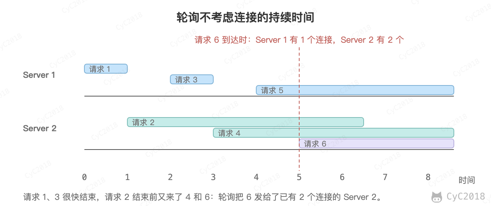 
 

最少连接算法就是将请求发送给当前最少连接数的服务器上。

例如下图中，服务器 1 当前连接数最小，那么新到来的请求 6 就会被发送到服务器 1 上。

 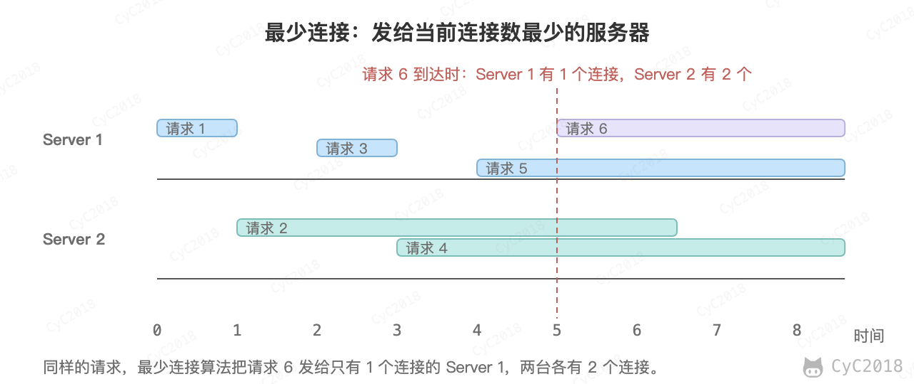 
 

#### 4. 加权最少连接（Weighted Least Connection）

在最少连接的基础上，根据服务器的性能为每台服务器分配权重，将请求发送给“当前连接数 / 权重”最小的服务器。

#### 5. 随机算法（Random）

把请求随机发送到服务器上。

和轮询算法类似，该算法比较适合服务器性能差不多的场景。

 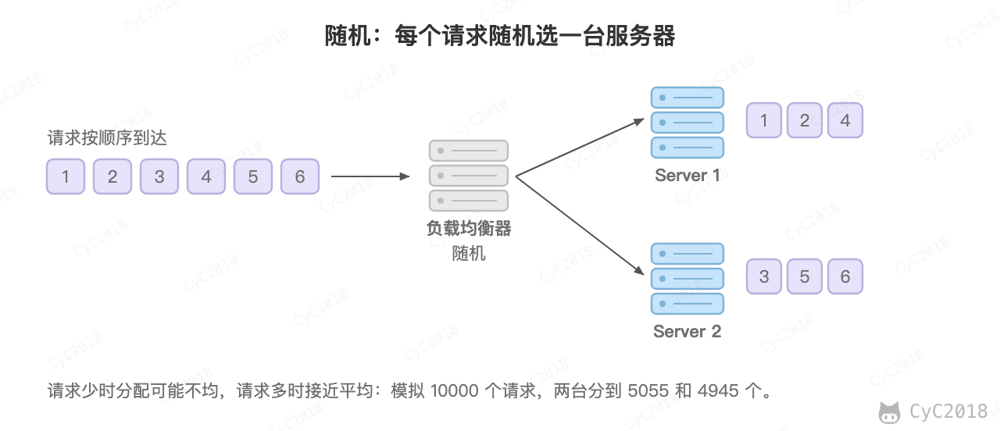 
 

#### 6. 源地址哈希法 (IP Hash)

源地址哈希通过对客户端 IP 计算哈希值之后，再对服务器数量取模得到目标服务器的序号。

可以保证同一 IP 的客户端的请求会转发到同一台服务器上，用来实现会话粘滞（Sticky Session）。

 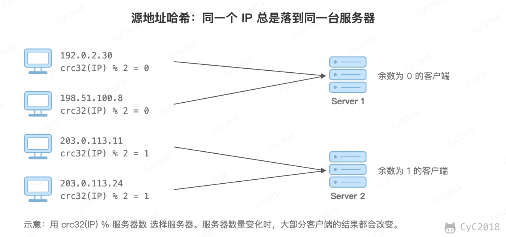 
 

缺点是同一出口 IP 后面的大量用户会落到同一台服务器上，造成负载不均；服务器数量变化时大部分客户端的取模结果都会改变，可以改用一致性哈希。需要注意的是，Nginx 的 ip_hash 只用 IPv4 地址的前 3 个字节计算哈希，同一个 /24 网段的客户端都会落到同一台服务器上。

### 转发实现

#### 1. HTTP 重定向

HTTP 重定向负载均衡服务器使用某种负载均衡算法计算得到服务器的 IP 地址之后，将该地址写入 HTTP 重定向报文中，状态码为 302。客户端收到重定向报文之后，需要重新向服务器发起请求。

缺点：

- 需要两次请求，因此访问延迟比较高；
- HTTP 负载均衡器处理能力有限，会限制集群的规模。

该负载均衡转发的缺点比较明显，实际场景中很少使用它。

 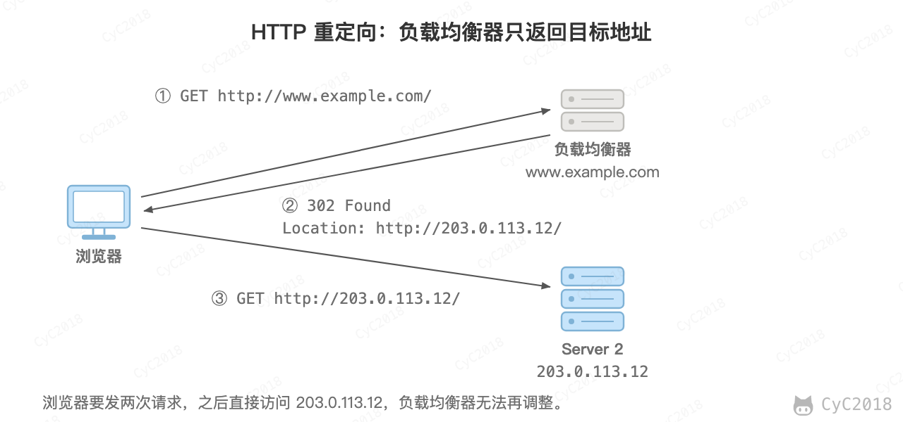 
 

#### 2. DNS 域名解析

在 DNS 解析域名的同时使用负载均衡算法计算服务器 IP 地址。

优点：

- DNS 能够根据地理位置进行域名解析，返回离用户最近的服务器 IP 地址。

缺点：

- 由于 DNS 具有多级结构，每一级的域名记录都可能被缓存，当下线一台服务器需要修改 DNS 记录时，需要过很长一段时间才能生效。

大型网站基本使用了 DNS 作为第一级负载均衡手段，然后在内部使用其它方式做第二级负载均衡。也就是说，域名解析的结果为内部的负载均衡服务器 IP 地址。

 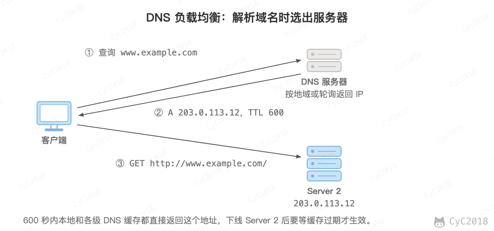 
 

#### 3. 反向代理服务器

反向代理服务器位于源服务器前面，用户的请求需要先经过反向代理服务器才能到达源服务器。反向代理可以用来进行缓存、日志记录等，同时也可以用来作为负载均衡服务器。

在这种负载均衡转发方式下，客户端不直接请求源服务器，因此源服务器不需要外部 IP 地址，而反向代理需要配置内部和外部两套 IP 地址。

反向代理工作在应用层，属于七层负载均衡，可以根据 URL、Cookie 等内容进行转发，常用的有 Nginx、HAProxy。

优点：

- 与其它功能集成在一起，部署简单。

缺点：

- 所有请求和响应都需要经过反向代理服务器，它可能会成为性能瓶颈。

#### 4. 网络层

在操作系统内核中获取网络数据包，根据负载均衡算法计算源服务器的 IP 地址，并修改请求数据包的目的 IP 地址，最后进行转发。

源服务器返回的响应也需要经过负载均衡服务器，通常是让负载均衡服务器同时作为集群的网关服务器来实现。对应 LVS 的 NAT 模式。

优点：

- 在内核进程中进行处理，性能比较高。

缺点：

- 和反向代理一样，所有的请求和响应都经过负载均衡服务器，会成为性能瓶颈。

#### 5. 链路层

在链路层根据负载均衡算法计算源服务器的 MAC 地址，并修改请求数据包的目的 MAC 地址，并进行转发。

通过配置源服务器的虚拟 IP 地址和负载均衡服务器的 IP 地址一致，从而不需要修改 IP 地址就可以进行转发。也正因为 IP 地址一样，所以源服务器的响应不需要转发回负载均衡服务器，可以直接转发给客户端，避免了负载均衡服务器成为瓶颈。

这是一种三角传输模式，被称为直接路由，对应 LVS 的 DR 模式，要求源服务器和负载均衡服务器位于同一个局域网内。对于提供下载和视频服务的网站来说，直接路由避免了大量的网络传输数据经过负载均衡服务器。

网络层和链路层的方式不解析应用层协议，属于四层负载均衡。链路层负载均衡的响应不经过负载均衡服务器，性能很好，在 Linux 平台可以使用的负载均衡服务器为 LVS（Linux Virtual Server），通常用 LVS 做四层负载均衡，再用 Nginx 做七层负载均衡。

参考：

- [Comparing Load Balancing Algorithms](http://www.jscape.com/blog/load-balancing-algorithms)
- [Nginx: ngx_http_upstream_module](https://nginx.org/en/docs/http/ngx_http_upstream_module.html)
- [Nginx 源码：ngx_http_upstream_round_robin.c](https://github.com/nginx/nginx/blob/master/src/http/ngx_http_upstream_round_robin.c)
- [Redirection and Load Balancing](https://web.archive.org/web/20250420002753/http://slideplayer.com/slide/6599069/)

## 二、集群下的 Session 管理

一个用户的 Session 信息如果存储在一个服务器上，那么当负载均衡器把用户的下一个请求转发到另一个服务器，由于服务器没有用户的 Session 信息，那么该用户就需要重新进行登录等操作。

### Sticky Session

需要配置负载均衡器，使得一个用户的所有请求都路由到同一个服务器，这样就可以把用户的 Session 存放在该服务器中。

缺点：

- 当服务器宕机时，将丢失该服务器上的所有 Session；
- 服务器不再是无状态的，不利于伸缩。

 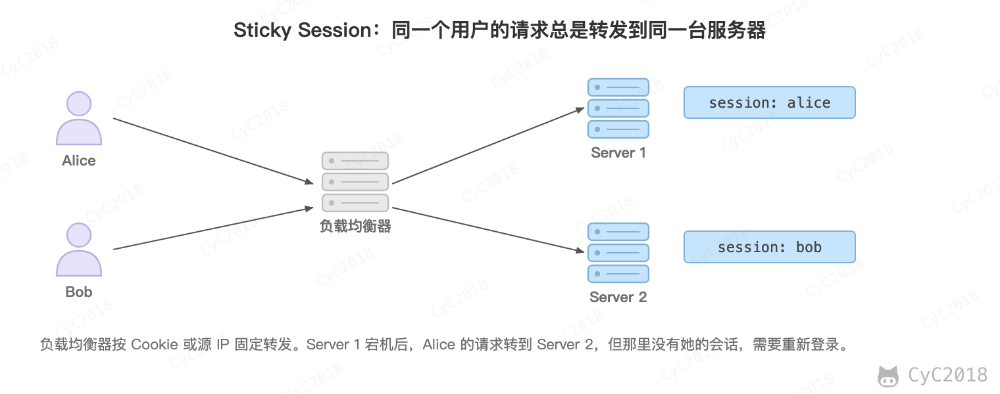 
 

### Session Replication

在服务器之间进行 Session 同步操作，每个服务器都有所有用户的 Session 信息，因此用户可以向任何一个服务器进行请求。

缺点：

- 占用过多内存；
- 同步过程占用网络带宽以及服务器处理器时间，因此只适合规模很小的集群。

 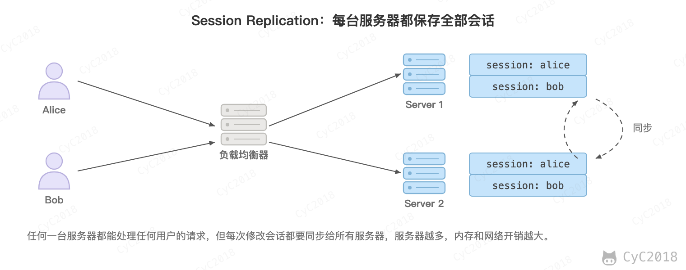 
 

### Session Server

使用一个单独的服务器存储 Session 数据，可以使用传统的 MySQL，也可以使用 Redis 或者 Memcached 这种内存型数据库。

优点：

- 为了使得大型网站具有伸缩性，集群中的应用服务器通常需要保持无状态，那么应用服务器不能存储用户的会话信息。Session Server 将用户的会话信息单独进行存储，从而保证了应用服务器的无状态。

缺点：

- 需要去实现存取 Session 的代码（Spring Session 等框架已经封装）；
- Session Server 本身需要保证高可用。

这是目前最常用的方式。

 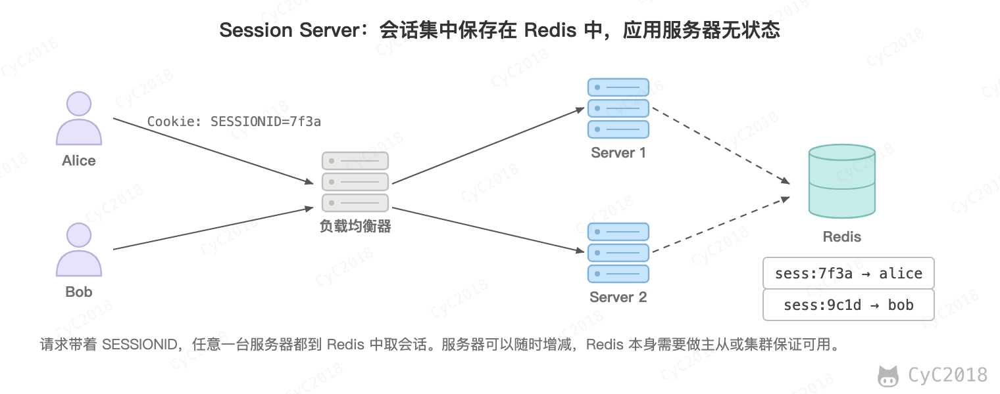 
 

### 客户端保存

把用户信息签名后放在 Cookie 或者 JWT 中，由客户端保存，服务端只需要验证签名。

缺点：

- 无法主动让某个会话失效。

参考：

- [Session Management using Spring Session with JDBC DataStore](https://web.archive.org/web/20230602191402/https://www.sivalabs.in/2018/02/session-management-using-spring-session-jdbc-datastore/)

